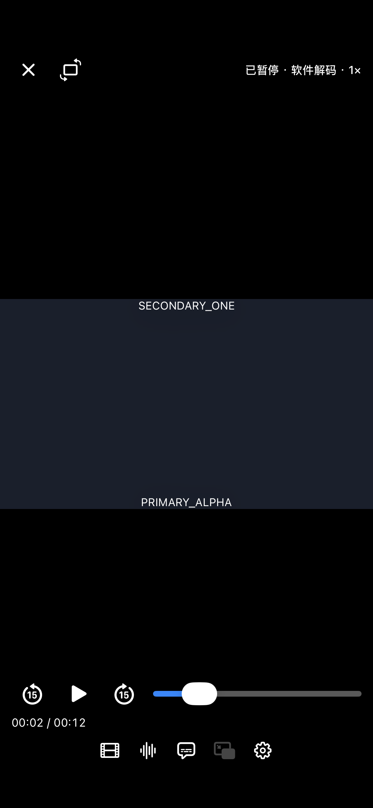
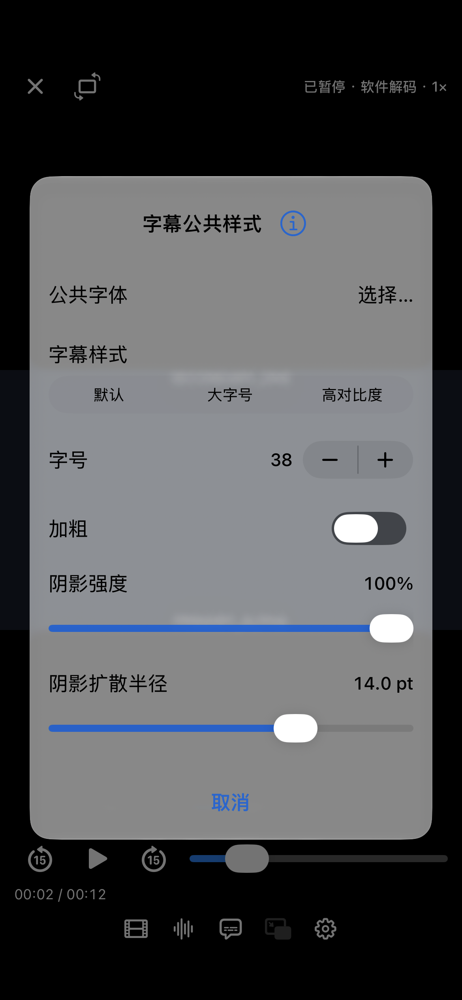

# 第二路字幕阴影扩散验证（2026-10-16）

## 实现与边界

- 两路文本在播放器样式下分别使用字幕覆盖层，支持公共阴影扩散半径；包括 SRT/VTT 和 ASS/SSA。
- 解码、cue 时间、两路正负延迟继续由原版 libmpv 管理。自绘时关闭对应原生绘制，位置、显隐和选择独立。
- 原始 ASS/SSA 与图片字幕仍走原生路径，能力提示保留。自绘不尝试还原原始 ASS 排版。
- 两路长期 ASS 偏好没有迁移或重置；实际 SRT/VTT 模式不回写偏好。
- 同来源复用轨道时，快照记录最近成功加载的资源地址，避免重建读取已失效的旧临时文件。
- Temby 同媒体重建保留共享字幕缓存，切换媒体和会话释放时清理，重新创建缓存后恢复活动目录登记。

## 实际验证

设备：iPhone 17e，iOS 27.0 模拟器，原版 libmpv，固定本地视频和字幕。

- 核心 34 项测试通过，0 失败。覆盖双路实际自绘、公共半径 0/14、正负延迟后实际文本、显隐/位置、ASS/SSA 与 SRT/VTT 切换、重复来源与失败/取消隔离、自动选轨实际 ASS 文本、持久化偏好、播放器重建、重建期间最新模式及基础样式。
- Temby 3 项测试通过，0 失败。包括两路格式/偏好循环、真实面板两层半径、原始模式混合提示、同媒体实际 destroy/replay 后两路自绘和第二路延迟/台词恢复。共享缓存前后存在性断言通过。
- LuWu 编译成功，实际宿主 18 项检查全部通过。结果保存在 LuWu 仓库 Tests/Reports/2026-10-16-SecondarySubtitleShadow/result.json。
- 目视核对两路上下位置和无遮挡呈现；图层断言确认两个标签的 shadowRadius 同为 14，第二路 nativeVisible 为 false。

本机结果包：`/private/tmp/SecondaryShadow-delivery.xcresult`、`/private/tmp/SecondaryShadow-temby-delivery.xcresult`。

需要私有在线片源的 `testLiveEpisodeCustomFontOutline` 未运行；不包含真机和在线服务器验收。Temby 离线测试中的空服务器状态同步 URL 错误不参与本地播放验收。

## 截图

